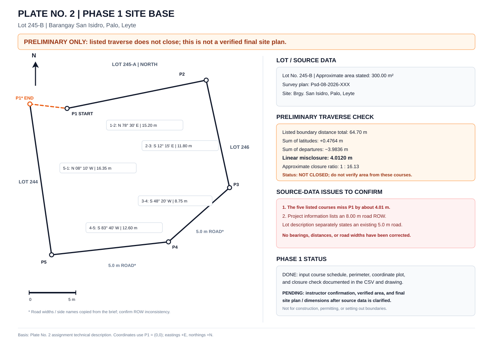

# CE 393 Plate No. 2

Project workspace for the proposed two-storey residential building plate.

## Current status

- Phase 1 site-base inputs and analysis are in the site folder.
- The academic plot closes by keeping courses 1-2 through 4-5 unchanged and using the documented adjusted P5-1 closing course.
- The assignment's 300.00 m² area is approximate. The adjusted closed polygon calculates to 265.26 m². Both values are documented; the plot is not forced to match the approximate figure.
- Drawing-generation and validation scripts, dependency documentation, folder notes, and a read-only GitHub Actions workflow are committed.
- GitHub Actions now generates the DXF and SVG preview, validates the outputs against the source CSV, and uploads a ZIP artifact on successful runs.
- The latest enhanced run passed: [view run and download artifact](https://github.com/justryan-n2d/plate_2_bsd/actions/runs/38008699847).
- Generated outputs are currently time-limited workflow artifacts, not automatically committed to the branch. Manual visual inspection in compatible CAD software remains required before accepting the drawing.

## Phase 1 site-base preview

See the [site folder README](site/README.md) for source files, assumptions, and verification limits.

## Project records

- [Project plan](plate2%20plan.md): assignment scope, required submissions, work plan, and drawing roadmap.
- [Calculation worksheet](calculations/plate2_calculations.md): calculation methods, values, and checks.
- [Traverse coordinate CSV](site/phase1_traverse_coordinates.csv): original and adjusted course records, coordinates, and closure diagnostics.
- [Site analysis](site/phase1_site_analysis.md): supported site findings and items requiring further verification.
- [Site analysis matrix](site/phase1_site_analysis_matrix.csv): site topics, evidence, status, and follow-up actions.

## Planned CAD workflow

1. Validate the existing traverse CSV.
2. Generate editable DXF geometry and a matching SVG preview from the same numeric source.
3. Check course components, coordinate closure, perimeter, polygon area, CAD units, layers, and output consistency.
4. Open the DXF in compatible CAD software and inspect it visually.
5. Convert a reviewed DXF to DWG when needed, then inspect the converted file.
6. Prepare and check the required PDF sheets.

DXF is the editable CAD master in this workflow. DWG is a converted delivery copy. The source CSV and generation code are the traceable sources for plotted geometry.

## Folder guide

- **calculations/**: calculation work and results.
- **site/**: current Phase 1 source data, drawing, and analysis.
- **data/**: future shared building model and schedules. The building model file will be added after the layout is actually defined.
- **scripts/**: drawing generation and validation tools.
- **previews/**: generated project-wide SVG previews. The existing Phase 1 SVG remains in site/ to preserve current links.
- **drawings/**: generated editable DXF masters.
- **exports/pdf/** and **exports/dwg/**: reviewed deliverables.
- **.github/workflows/**: automated validation checks.

## Local commands

Use Python 3.11 or newer, from the repository root:

    python -m pip install -r scripts/requirements.txt
    python scripts/validate_site_base.py
    python scripts/generate_site_base.py

The generator writes drawings/phase1_site_base.dxf and previews/phase1_site_base_preview.svg. The workflow runs the source validator, generates both files, validates the generated DXF and SVG, and uploads them as the `plate2-phase1-cad-*` artifact for 14 days. See [GitHub Actions](https://github.com/justryan-n2d/plate_2_bsd/actions/workflows/validate-drawings.yml) and open the latest successful run to download the files. Generated CAD output remains preliminary until inspected in compatible CAD software.

## Limits

- The adjusted traverse is an academic plotting basis under the instructor's direction, not cadastral survey certification.
- The 5.0 m road width and 8.00 m right-of-way are separate stated values. No precise allocation of the remaining 3.0 m is assumed.
- Exact road/ROW edges, site levels, drainage, obstructions, setbacks, and parcel-specific hazard results are not inferred from the local coordinate plot.
- Automated checks do not establish code compliance, structural adequacy, permit readiness, or construction readiness.
