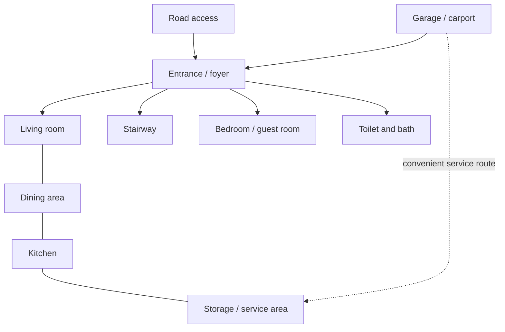
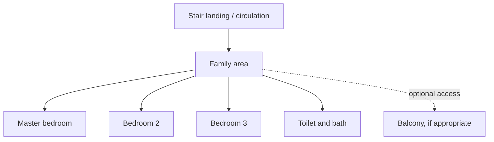

# Phase 3: Preliminary Space Program and Adjacency

**Project:** CE 393 Plate No. 2, Proposed Two-Storey Residential Building  
**Status:** First planning draft. Required spaces come from the instructor's assignment; dimensions and areas below are proposed design targets, not values prescribed by the assignment.

## 1. Design basis

- Occupancy group: A.
- Initial construction type: Type V-A.
- Proposed occupants: 5-6 persons.
- Working site-envelope basis: 2.00 m inset from each of the five plotted lot edges, giving a 152.43 m² working envelope for layout.
- Road cross-section: 8.00 m total RROW = 5.00 m barangay road + 1.50 m strip on each side, as specified by the instructor.
- The space list below preserves the room names in the assignment. Any extra space or dimension may be revised as the plans are coordinated.

## 2. Ground-floor space requirement table

| Required space | Proposed clear room/slot dimensions | Target area | Planning notes |
|---|---:|---:|---|
| Entrance / foyer | 1.50 m × 2.00 m | 3.00 m² | Direct, clear entry from the pedestrian path |
| Living room | 3.50 m × 4.00 m | 14.00 m² | Near entrance; connects to dining |
| Dining area | 2.80 m × 3.00 m | 8.40 m² | Between living and kitchen for easy serving |
| Kitchen | 3.00 m × 3.00 m | 9.00 m² | Adjacent to dining and service/storage |
| Toilet and bath | 1.50 m × 2.00 m | 3.00 m² | Accessible from circulation; near guest room without opening directly into dining |
| Bedroom / guest room | 3.00 m × 3.00 m | 9.00 m² | Quieter area away from the main living path |
| Stairway | 2.00 m × 4.00 m | 8.00 m² | Near central circulation; final stair geometry to be calculated separately |
| Storage / service area | 1.50 m × 2.00 m | 3.00 m² | Close to kitchen and the service route |
| Garage / carport parking slot | 2.50 m × 5.00 m | 12.50 m² | One preliminary car slot; driveway and turning clearance are additional |
| **Programmed ground-floor subtotal** |  | **69.90 m²** | Includes the parking-slot rectangle; excludes wall thickness and any additional driveway/turning area |

Ground-floor rooms other than the carport total **57.40 m²** as initial clear-area targets. For early massing only, allow roughly 15% for wall thickness and room-to-room circulation, giving about **66.01 m²** enclosed ground-floor gross area plus the **12.50 m²** parking-slot rectangle. This is an early estimate, not a measured plan area.

## 3. Second-floor space requirement table

| Required space | Proposed clear room dimensions | Target area | Planning notes |
|---|---:|---:|---|
| Master bedroom | 3.50 m × 4.00 m | 14.00 m² | Preferably the most private bedroom |
| Bedroom 2 | 3.00 m × 3.00 m | 9.00 m² | Place near the common bathroom |
| Bedroom 3 | 3.00 m × 3.00 m | 9.00 m² | Place near the common bathroom |
| Toilet and bath | 1.50 m × 2.00 m | 3.00 m² | Coordinate with first-floor wet area where practical |
| Family area | 3.00 m × 3.50 m | 10.50 m² | At the top of the stairs, with access to the bedrooms |
| Stair landing / circulation | 2.00 m × 3.00 m | 6.00 m² | Must remain clear and connect all upper-floor spaces |
| Balcony, if appropriate | 1.20 m × 3.00 m | 3.60 m² | Optional; include only if it fits the envelope and elevation design |
| **Programmed second-floor subtotal** |  | **55.10 m²** | Includes the optional balcony; excludes wall thickness |

The second-floor clear-area targets total **51.50 m²** before the optional **3.60 m²** balcony. For early massing only, allowing roughly 15% for wall thickness and partitions suggests about **59.23 m²** enclosed gross area. Recalculate these values from the dimensioned plan once the layout is fixed.

### Early area target (not a final calculation)

- Enclosed ground floor: about 66.01 m².
- Enclosed second floor: about 59.23 m².
- Initial total enclosed floor-area target: about **125.24 m²**.
- Parking slot: 12.50 m², separately identified.
- Optional balcony: 3.60 m², separately identified.

These estimates do not establish the final footprint. The building, parking, driveway, and access path still have to fit within the 152.43 m² working envelope without blocking circulation or placing any parking area in the road right-of-way.

## 4. Adjacency and relationship diagram

### Ground floor

### Second floor

## 5. Relationship priorities

| Relationship | Design priority |
|---|---|
| Living room - dining area | Direct connection; open and convenient for family activities |
| Dining area - kitchen | Direct connection; short food/service route |
| Kitchen - storage/service | Close connection; keep service activity out of the main entrance |
| Entrance - stairway | Easy to find without walking through private rooms |
| Guest room - toilet and bath | Convenient access while maintaining privacy |
| Bedrooms - family area | Short, legible circulation; avoid routing through another bedroom |
| Bedrooms - common bathroom | Convenient but with bathroom door kept out of direct view from main family space |
| Carport - entrance | Safe pedestrian route with minimal conflict with vehicle movement |
| Carport - kitchen/service | Optional convenient route for bringing in groceries, without crossing the main living area |

## 6. Next layout checks

1. Fit the proposed rooms into an efficient ground-floor footprint inside the 152.43 m² working envelope. Do not assume the full envelope becomes building area.
2. Arrange the required second-floor rooms over the available ground-floor footprint; coordinate bathrooms and the stair location between floors.
3. Confirm door swings, window locations, natural ventilation, privacy, furniture clearances, and circulation.
4. Recalculate footprint, floor areas, total floor area, and remaining open space from the dimensioned plans.
5. Calculate stair risers, tread, width, landings, and floor-to-floor height after the plan geometry is drafted.
6. Position the 2.50 m × 5.00 m parking slot and driveway within the site, outside the RROW, with an additional check for vehicle access.

**Use limit:** This is a first space-planning proposal based on the assignment's required spaces. The room dimensions are adjustable design targets; they should not be presented as instructor-given figures or final measured areas.
